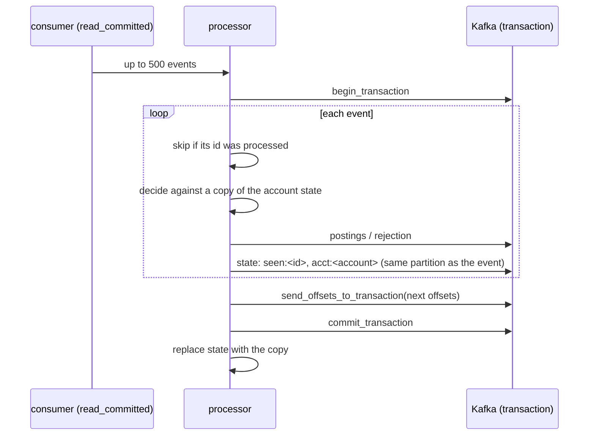

# Architecture

## Topics

| Topic | Key | Written by | Notes |
|---|---|---|---|
| `<prefix>.payments` | account | gateway (idempotent producer) | input, 6 partitions |
| `<prefix>.ledger` | account of the posting | processor, transactionally | two postings per accepted event |
| `<prefix>.payments-rejected` | account | processor, transactionally | one per rejected event |
| `<prefix>.processor-state` | `acct:<id>`, `seen:<event id>` | processor, transactionally | compacted, co-partitioned with `payments` |

## One processor batch



If anything fails before the commit, the transaction is aborted, the consumer seeks back to the
batch's first offsets, and the copy is discarded. If the process dies, the next instance's
`init_transactions` aborts the open transaction, and the consumer group resumes from the last
committed offsets. The changelog is restored only up to committed records.

## Sink

```mermaid
sequenceDiagram
    participant C as consumer (read_committed)
    participant S as sink
    participant D as PostgreSQL
    S->>D: read sink_offsets
    S->>C: assign partitions at those offsets
    C->>S: up to 1,000 postings
    S->>D: BEGIN; INSERT postings; UPSERT sink_offsets; COMMIT
```

## Reconciliation

`reconcile.py` regenerates the gateway's events, applies them once each with the same rules
(`model.Ledger`), and compares that with the committed contents of the ledger and rejection
topics, the database rows, double entry per event and overall, and every account's balance.
